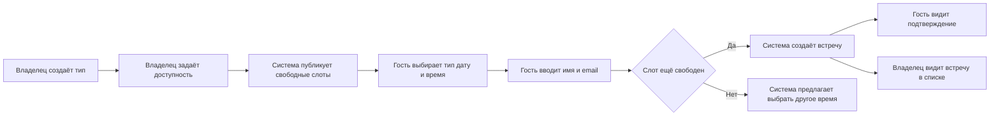

# Бизнес требования к MVP Запись на звонок

Этот документ определяет бизнес-цели, границы и обязательные требования к минимальной версии сервиса бронирования времени. MVP должен обеспечивать законченный процесс: владелец создаёт тип встречи и публикует доступность, гость бронирует свободный 30-минутный слот, владелец видит новую встречу в списке предстоящих.

## Паспорт документа

| Параметр      | Значение                                                |
| ------------- | ------------------------------------------------------- |
| Тип документа | Business Requirements Document                          |
| Версия        | 1.0                                                     |
| Статус        | Черновик для согласования                               |
| Дата          | 11 октября 2026 года                                    |
| Продукт       | Запись на звонок                                        |
| Основание     | `product/research.md` и `Описание проекта.docx`         |
| Аудитория     | Владелец продукта, разработчики, дизайнер и тестировщик |

## 1 Резюме

«Запись на звонок» — однопользовательский сервис для публикации свободного времени и самостоятельной записи гостей. Он решает проблему ручного согласования даты и времени в переписке.

В MVP один владелец управляет несколькими типами встреч и единым недельным расписанием. Гость без регистрации выбирает тип, дату и время, вводит имя и email и получает подтверждение. Каждая встреча длится 30 минут. Система использует только собственные данные о бронированиях и не подключается к внешним календарям.

Результатом проекта считается развёрнутое приложение, в котором полностью работает основной сценарий и исключено двойное бронирование одного времени.

## 2 Бизнес проблема

Организатор звонка вынужден вручную предлагать варианты времени, проверять ответы и фиксировать договорённость. Это создаёт лишнюю переписку и допускает ошибки: выбранное время может быть уже занято, а данные о будущих встречах могут храниться в разных местах.

Гость, в свою очередь, не видит доступные интервалы и зависит от ответа организатора. Минимальный сервис должен заменить это взаимодействие одной публичной страницей с актуальными слотами.

## 3 Бизнес цели

| ID      | Цель                                        | Признак достижения                                                               |
| ------- | ------------------------------------------- | -------------------------------------------------------------------------------- |
| OBJ-001 | Сократить ручное согласование времени       | Гость может записаться без переписки с владельцем                                |
| OBJ-002 | Создать единый источник доступности         | Публичная страница показывает слоты из сохранённого расписания                   |
| OBJ-003 | Исключить конфликт записей                  | Один 30-минутный интервал не может быть забронирован дважды                      |
| OBJ-004 | Дать владельцу обзор ближайших обязательств | Новая запись появляется в хронологическом списке предстоящих встреч              |
| OBJ-005 | Подготовить законченный учебный продукт     | Основной путь работает после развёртывания в облаке без ручного изменения данных |

Количественные цели по конверсии, числу пользователей и выручке для MVP не устанавливаются. Первая версия проверяет работоспособность процесса, а не рыночный масштаб.

## 4 Заинтересованные стороны и роли

| Роль               | Интерес и ответственность                                                     |
| ------------------ | ----------------------------------------------------------------------------- |
| Владелец продукта  | Согласует границы MVP и принимает результат                                   |
| Владелец календаря | Создаёт типы встреч, задаёт доступность и просматривает будущие записи        |
| Гость              | Выбирает свободное время и оформляет запись без регистрации                   |
| Команда разработки | Реализует требования, целостность данных и развёртывание                      |
| Тестировщик        | Проверяет основной путь, ошибки, пустые состояния и конкурентное бронирование |

В рамках MVP владелец календаря не является отдельной учётной записью. Раздел управления доступен по выделенным маршрутам, но не защищён авторизацией.

## 5 Область проекта

### Входит в MVP

- список, создание и редактирование типов встреч;
- название, описание и уникальная публичная ссылка типа;
- фиксированная длительность встречи 30 минут;
- одно недельное расписание владельца;
- один настроенный часовой пояс;
- публичный список типов встреч;
- прямая ссылка на страницу конкретного типа;
- календарь доступных дат и список свободного времени;
- форма записи с именем, email и необязательным примечанием;
- экран подтверждения;
- защита от двойного бронирования;
- список предстоящих встреч владельца;
- состояния загрузки, пустые состояния, валидация и обработка ошибок;
- адаптивный интерфейс и управление с клавиатуры;
- развёртывание приложения и базы данных в облаке.

### Не входит в MVP

- регистрация, вход и разграничение прав;
- несколько владельцев и личные кабинеты;
- интеграции с Google Calendar, Outlook и другими календарями;
- Zoom, Google Meet и автоматическая генерация ссылок;
- email, SMS и push-уведомления;
- длительности, отличные от 30 минут;
- выбор длительности гостем;
- команды, коллективные встречи и round-robin;
- повторяющиеся встречи;
- платежи;
- гости и настраиваемые вопросы;
- подтверждение заявки владельцем;
- отмена и перенос встречи;
- аналитика, поиск и фильтры;
- полноценный выбор часового пояса;
- история и интерфейс прошедших встреч.

Функции из этого списка могут быть рассмотрены после приёмки P0. Они не должны задерживать выпуск минимальной версии.

## 6 Целевой бизнес процесс

### Процесс владельца

1. Открыть раздел управления.
2. Создать тип встречи.
3. Задать недельное расписание.
4. Открыть публичную страницу и проверить доступные слоты.
5. Передать гостю общую или прямую ссылку.
6. Просмотреть поступившие записи в разделе предстоящих встреч.

### Процесс гостя

1. Открыть публичную страницу или прямую ссылку.
2. Выбрать тип встречи.
3. Выбрать доступную дату.
4. Выбрать свободный 30-минутный слот.
5. Ввести имя, email и при необходимости примечание.
6. Подтвердить запись.
7. Получить подтверждение на экране.

## 7 Бизнес требования

Приоритет `Must` означает обязательность для выпуска MVP. Приоритет `Should` означает желательное требование, которое не должно ставить под угрозу основной путь.

| ID     | Требование                                                         | Приоритет | Критерий выполнения                                                   |
| ------ | ------------------------------------------------------------------ | --------- | --------------------------------------------------------------------- |
| BR-001 | Владелец должен создавать тип встречи                              | Must      | Корректно заполненный тип сохраняется и появляется в управлении       |
| BR-002 | Владелец должен редактировать название и описание типа             | Must      | Изменения отображаются на публичной странице                          |
| BR-003 | Каждый тип должен иметь уникальную прямую ссылку                   | Must      | Ссылка открывает выбранный тип без дополнительных переходов           |
| BR-004 | Все встречи должны иметь фиксированную длительность 30 минут       | Must      | Пользователь не может выбрать или сохранить другую длительность       |
| BR-005 | Владелец должен задавать недельное расписание                      | Must      | Сохранённые интервалы используются при расчёте слотов                 |
| BR-006 | Система должна показывать гостю опубликованные типы                | Must      | На публичной странице видны название, описание и длительность         |
| BR-007 | Система должна показывать только доступные даты и время            | Must      | Прошедшие и полностью занятые даты нельзя выбрать                     |
| BR-008 | Гость должен бронировать слот без регистрации                      | Must      | Запись создаётся по имени и email                                     |
| BR-009 | Перед подтверждением гость должен видеть сводку встречи            | Must      | На форме показаны тип, дата, время, длительность и часовой пояс       |
| BR-010 | Система должна атомарно проверять слот при подтверждении           | Must      | Одновременно сохранить один слот может только один гость              |
| BR-011 | После записи гость должен получить явное подтверждение             | Must      | Экран успеха содержит основные сведения о встрече                     |
| BR-012 | Владелец должен видеть предстоящие встречи                         | Must      | Встречи показаны от ближайшей к более поздним                         |
| BR-013 | Система должна объяснять отсутствие данных                         | Must      | Для типов, расписания, слотов и встреч предусмотрены пустые состояния |
| BR-014 | Ошибка не должна вынуждать гостя заново вводить данные             | Should    | После повторяемой ошибки значения формы остаются на экране            |
| BR-015 | Интерфейс должен работать на телефоне и компьютере                 | Must      | Основной путь доступен на узком и широком экране                      |
| BR-016 | Основной путь должен быть доступен с клавиатуры                    | Must      | Поля, даты, слоты и кнопки имеют доступный фокус и управление         |
| BR-017 | Приложение должно разворачиваться вместе с постоянной базой данных | Must      | После перезапуска сохранённые типы, расписание и встречи не исчезают  |

## 8 Бизнес правила

| ID       | Правило                                                                                  |
| -------- | ---------------------------------------------------------------------------------------- |
| RULE-001 | В системе существует один владелец календаря                                             |
| RULE-002 | Длительность любого типа и любой встречи равна 30 минутам                                |
| RULE-003 | Все типы используют одно глобальное недельное расписание                                 |
| RULE-004 | Для каждого дня MVP поддерживает не более одного интервала доступности                   |
| RULE-005 | Начало интервала должно быть раньше окончания и вмещать минимум один слот                |
| RULE-006 | Начало слота выравнивается по получасовой сетке                                          |
| RULE-007 | Слот должен целиком находиться внутри интервала доступности                              |
| RULE-008 | Гость может выбирать только будущие слоты в пределах 30 дней                             |
| RULE-009 | Бронь любого типа блокирует то же время для всех остальных типов                         |
| RULE-010 | Свободность слота повторно проверяется на сервере в момент подтверждения                 |
| RULE-011 | Имя и email обязательны, примечание необязательно                                        |
| RULE-012 | Предстоящей считается встреча, время начала которой ещё не наступило                     |
| RULE-013 | Предстоящие встречи сортируются по времени начала по возрастанию                         |
| RULE-014 | Неизвестный или недоступный `slug` приводит на понятную страницу «Тип встречи не найден» |
| RULE-015 | Интерфейс не обещает письмо, календарное событие или ссылку на звонок                    |
| RULE-016 | Один часовой пояс явно показывается на календаре, форме и экране успеха                  |

## 9 Требования к данным

### Тип встречи

Система хранит название, уникальный `slug`, необязательное описание, фиксированную длительность, признак активности и время создания или изменения.

### Доступность

Система хранит день недели, включённость дня, время начала и окончания, а также единый часовой пояс расписания.

### Бронирование

Система хранит тип встречи, время начала и окончания, имя гостя, email, необязательное примечание и время создания записи.

Имя, email и примечание являются пользовательскими данными. Они не должны передаваться в URL, попадать в публичные страницы или выполняться как HTML или скрипт. Срок хранения и процедура удаления этих данных должны быть определены до использования продукта с реальными пользователями.

## 10 Нефункциональные требования

| ID      | Область            | Требование                                                                                             |
| ------- | ------------------ | ------------------------------------------------------------------------------------------------------ |
| NFR-001 | Целостность        | Ограничение базы данных должно запрещать две активные брони одного времени                             |
| NFR-002 | Надёжность         | Повторное нажатие кнопки не должно создавать дубликат                                                  |
| NFR-003 | Время              | Сервер и интерфейс должны однозначно интерпретировать момент встречи                                   |
| NFR-004 | Безопасность       | Ввод валидируется на сервере, а пользовательский текст экранируется при выводе                         |
| NFR-005 | Конфиденциальность | Email и имя гостя доступны только в разделе управления, насколько это позволяет отсутствие авторизации |
| NFR-006 | Удобство           | На каждом шаге видны выбранные тип, дата и время                                                       |
| NFR-007 | Доступность        | Основной путь поддерживает клавиатуру, видимый фокус и понятные подписи                                |
| NFR-008 | Адаптивность       | Основной путь остаётся пригодным для использования на мобильном экране                                 |
| NFR-009 | Восстановление     | При временной ошибке доступна повторная попытка без необязательной потери ввода                        |
| NFR-010 | Развёртывание      | Конфигурация окружения и схема базы воспроизводимо применяются в облаке                                |

Формальный SLA по времени ответа и доступности для учебного MVP не устанавливается.

## 11 Состояния и исключения

| Ситуация                          | Требуемое поведение                                                                          |
| --------------------------------- | -------------------------------------------------------------------------------------------- |
| Типов встреч нет                  | Раздел владельца предлагает создать тип, публичная страница сообщает об отсутствии вариантов |
| Расписание не настроено           | Слоты не генерируются, владелец получает переход к настройке                                 |
| На выбранный период нет слотов    | Гость видит сообщение об отсутствии свободного времени                                       |
| Слот заняли до отправки формы     | Встреча не создаётся, список времени обновляется, данные гостя сохраняются                   |
| Два гостя подтверждают один слот  | Успех получает только один запрос, второй получает контролируемый конфликт                   |
| Email имеет неверный формат       | Запись не отправляется, ошибка показана рядом с полем                                        |
| Сервер временно недоступен        | Показана понятная ошибка и кнопка повторной попытки                                          |
| Открыта неизвестная ссылка        | Показана страница 404 с возвратом к списку типов                                             |
| Нажатие подтверждения повторяется | Кнопка блокируется на время запроса, дубликат не создаётся                                   |

## 12 Допущения и ограничения

- Продукт создаётся как учебный MVP, а не как готовая многопользовательская SaaS-платформа.
- Владелец календаря один, поэтому занятость общая для всех типов встреч.
- Внешние события не влияют на доступность, поскольку календарных интеграций нет.
- Гость не создаёт аккаунт и не управляет встречей после записи.
- Часовой пояс задаётся конфигурацией продукта и одинаково используется при расчётах и показе времени.
- Публичный горизонт бронирования ограничен 30 днями.
- Для работы требуется постоянная база данных.
- Раздел управления не считается защищённым до появления авторизации.

## 13 Зависимости

- выбранная технология должна поддерживать серверную транзакцию или эквивалентный атомарный механизм;
- база данных должна поддерживать уникальное ограничение для защиты времени встречи;
- облачная среда должна поддерживать приложение, переменные окружения и постоянное хранилище;
- до выпуска должен быть установлен конкретный часовой пояс приложения;
- маршруты публичной части и управления должны быть согласованы с навигацией продукта.

## 14 Риски и меры

| Риск                         | Влияние                                       | Мера                                                                                     |
| ---------------------------- | --------------------------------------------- | ---------------------------------------------------------------------------------------- |
| Одновременное бронирование   | Два гостя получают одно время                 | Серверная транзакция и уникальное ограничение                                            |
| Несогласованное время        | Гость и владелец видят разные интервалы       | Один часовой пояс и единый формат хранения времени                                       |
| Открытый раздел управления   | Посторонний может увидеть или изменить данные | Явно ограничить использование демо-средой; добавить авторизацию до реальной эксплуатации |
| Хранение персональных данных | Имя и email могут быть раскрыты               | Не помещать данные в URL и логи, определить срок хранения до реального запуска           |
| Расширение объёма            | Выпуск задерживается вторичными функциями     | Функции вне P0 не реализовывать до прохождения критериев выпуска                         |
| Пустая первая сессия         | Пользователь не понимает следующий шаг        | Понятные пустые состояния и одна основная кнопка действия                                |

## 15 Критерии выпуска

MVP может быть принят и выпущен, если одновременно выполнены условия:

1. Все требования с приоритетом `Must` реализованы.
2. Владелец может создать и отредактировать тип без прямой работы с базой данных.
3. Владелец может настроить недельную доступность.
4. Гость может пройти путь от публичной страницы до подтверждения записи.
5. Новая запись появляется в списке предстоящих встреч.
6. Забронированный слот исчезает для всех типов встреч.
7. Автоматический или воспроизводимый тест подтверждает, что два параллельных запроса не создают две встречи на одно время.
8. Проверены пустые состояния и основные ошибки.
9. Основной путь проверен на мобильном экране и с клавиатуры.
10. Приложение развёрнуто в облаке и сохраняет данные после перезапуска.
11. Интерфейс не обещает функции, исключённые из MVP.

## 16 Матрица соответствия целей и требований

| Цель                                  | Поддерживающие требования               |
| ------------------------------------- | --------------------------------------- |
| OBJ-001 Сократить согласование        | BR-003, BR-006, BR-007, BR-008, BR-011  |
| OBJ-002 Создать источник доступности  | BR-005, BR-007, BR-017                  |
| OBJ-003 Исключить конфликты           | BR-010, NFR-001, NFR-002                |
| OBJ-004 Дать обзор встреч             | BR-012, RULE-012, RULE-013              |
| OBJ-005 Выпустить законченный продукт | BR-013, BR-015, BR-016, BR-017, NFR-010 |

## 17 Открытые решения

До начала финальной реализации необходимо подтвердить:

| Решение                           | Рекомендуемый вариант                       | Причина                                              |
| --------------------------------- | ------------------------------------------- | ---------------------------------------------------- |
| Часовой пояс приложения           | Один часовой пояс из конфигурации окружения | Исключает неоднозначность без полноценного селектора |
| Первичное расписание              | Пустое, требующее явной настройки           | Не публикует время без решения владельца             |
| Поведение при одном типе          | Сохранять публичный список                  | Путь остаётся одинаковым при появлении второго типа  |
| Срок хранения персональных данных | Определить до реальной эксплуатации         | Имя и email являются персональными данными           |
| Отображаемое имя владельца        | Задать конфигурацией или текстом продукта   | Учётной записи владельца в MVP нет                   |

Открытые решения не блокируют проектирование основных сущностей и процесса, но должны быть закрыты до приёмки пользовательского интерфейса и публикации реальных ссылок.

## 18 Источники

- [Исследование продукта](research.md).
- `Описание проекта.docx`.
- [Cal.com руководство по типам встреч](https://cal.com/blog/event-types-guide-calcom).
- [Cal.com документация процесса бронирования](https://cal.com/docs/platform/atoms/booker).
- [Cal.com обзор панели бронирований](https://cal.com/blog/a-complete-walkthrough-of-cal-com-s-booking-dashboard-its-key-features).
